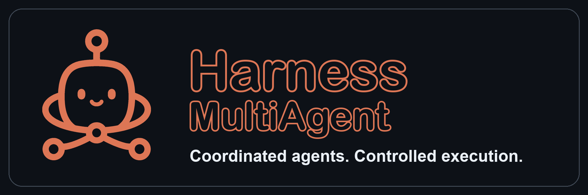

# MultiAgent Orchestration — Claude · Codex · Gemini · Ollama



Claude Code 세션을 오케스트레이터로 두고, Claude·Codex·Gemini·Ollama(셀프 호스팅 LLM)를 필요할 때 워커로 호출하는 **파일 기반 멀티에이전트 시스템**입니다.
실무(레거시 엔터프라이즈 Java/C# 제품 유지보수)에 실제로 적용하며 운영 규칙·교훈을 쌓아 온 구성입니다.

> 기반: [netwaif/multi-agent-starter](https://github.com/netwaif/multi-agent-starter) (MIT) 를 설치한 뒤 확장했습니다. 아래 "이 저장소에서 확장한 것" 참조.

## 핵심 아이디어

- **Orchestrator = Claude Code 세션** — 이 폴더에서 실행하면 `CLAUDE.md`가 적용됩니다. 추론은 직접 하고, 실제 작업은 워커에 위임합니다.
- **Worker = 별도 모델 호출** — 모든 워커 호출은 승인 게이트(`task.md`의 `workers_approved`)를 통과해야 합니다.

  | 워커 | 역할(능력 슬롯) |
  |------|----------------|
  | `claude-main` | strategist — 기획·설계·디버깅 원인 분석 |
  | `codex-main` | engineer — 대규모 구현·테스트·diff·로컬 검증 |
  | `codex-critic` | reviewer — 산출물 리뷰·비평 |
  | `ollama` | reviewer — 벤더 쿼터 없는 셀프 호스팅 보조 검증 |
  | `gemini` | multimodal — 이미지·긴 문서·제3자 시각 검토 |

  슬롯→워커 배정 정본은 `_shared/capability-profile.md`(가변층). 신모델이 나오면 프로필만 갱신합니다.
- **Memory = filesystem** — 런타임 상태가 없습니다. 모든 결정·승인·검증이 `tasks/<task>/` 아래 파일로 남습니다.

## 작업 흐름

```
요청 → task.md 작성 → 최소 worker set 결정(routing.md) → 사용자 승인
     → workers/<role>/brief.md 작성 → 워커 실행 → result.md 저장
     → Verification Checklist 실행 → log.md에 [VERIFICATION] 기록 → 교훈 축적
```

## 폴더 구조

```
.
├── CLAUDE.md / AGENTS.md     # 오케스트레이터 운영 규칙 (Claude / Codex flavor)
├── .claude/agents/           # ① 워커 풀(claude-main) + ② 도메인 서브에이전트(frontend-expert)
├── _shared/
│   ├── routing.md            # 워커 선택 decision tree
│   ├── capability-profile.md # 능력 슬롯 → 워커 배정 (가변층)
│   ├── approval-policy.md    # 승인 게이트
│   ├── orchestrator-rules.md # 세션 시작·재진입 프로토콜
│   ├── system-invariants.md  # 시스템 자기모순 점검 (INV1–12) + check-invariants.sh
│   ├── code-comment-policy.md
│   ├── learnings.md          # 실무에서 얻은 운영 교훈
│   └── adapters/             # call_worker.sh 디스패처 + 워커별 어댑터
├── _templates/               # task / brief / result / log 템플릿
├── tasks/                    # 작업 폴더 (git 비추적, 아래 샘플만 포함)
├── knot-vault/               # 에이전트 공용 지식 vault (선택)
└── monitoring/               # mat — 작업 진행 TUI 모니터 (netwaif/mat 기반)
```

## 샘플 task

실제 수행한 작업을 익명화했습니다(제품·경로·테이블명 치환). task.md → brief → result → 검증 흐름을 그대로 볼 수 있습니다.

| task | 보여주는 것 |
|------|------------|
| [`worker-smoke-test`](tasks/worker-smoke-test/) | Claude·Codex(main/critic)·Ollama 4개 워커 실제 호출 검증, MCP 미등록 시 CLI 폴백 |
| [`scheduler-misfire-analysis`](tasks/scheduler-misfire-analysis/) | claude-main 원인 분석(jar 바이트코드 근거) → codex-critic 적대적 교차검증이 수정안의 치명적 결함을 발견 → Orchestrator 재확인 후 안전한 안만 적용 |
| [`source-highlight-fix`](tasks/source-highlight-fix/) | 리뷰 워커가 디스패처 버그(Windows `jq` CRLF)로 실패 → 원인 규명 후 대체 리뷰어로 우회, 리뷰 15건을 반영/보류로 분류 |

> 오래된 task 정리 규칙에 따라 일부 `log.md`는 `[COMPLETE]`/`[FINDING]` 항목만 남아 있습니다.

## 핵심 원칙

| 원칙 | 강제 방식 |
|------|-----------|
| 모든 워커 호출 전 승인 | `task.md`의 `workers_approved` |
| 측정 가능한 컨텍스트 한도 | `context.md` ≤ 1500자, `brief.md` ≤ 1200자 (`wc -m`) |
| append-only 로그 | `log.md` 수정·삭제 금지 (완료 task만 정리 예외) |
| 결과 수락 전 검증 | `result.md`의 Verification Checklist → `[VERIFICATION]` |
| 외부 repo 쓰기 4조건 | `target_repo` + `write_scope` + 승인 + log `[APPROVAL]` |
| 파괴적 git·빌드 금지 | 조회 전용 git만 허용, 커밋·빌드는 사용자가 직접 |

## 이 저장소에서 확장한 것

- **Ollama 워커** — 벤더 쿼터 없이 돌릴 수 있는 셀프 호스팅 리뷰어 (`_shared/adapters/ollama_api.sh`)
- **도메인 서브에이전트 계층** — 승인 게이트 대상인 워커 풀과 분리된 "실제 개발용" 에이전트 계층 (`.claude/agents/README.md`)
- **flavor 전환 스크립트** — Claude 사용량 소진 시 Codex 오케스트레이터로 전환/복귀 (`_shared/switch-flavor.sh`)
- **코드 주석 정책** — 워커가 반환한 코드의 주석을 오케스트레이터가 재검토하는 규칙 (`_shared/code-comment-policy.md`)
- **운영 교훈 축적** — 실무 적용 중 겪은 실패·우회법 20여 건 (`_shared/learnings.md`)
  예: 워커의 자기 검증 서술을 신뢰하지 않고 `git diff`로 재검증, 두 워커 간 인터페이스 wire-type 불일치, Windows `jq` CRLF로 인한 CLI 워커 전면 실패, SQL 리라이트의 `MINUS` 양방향 검증
- **knot-vault** — 여러 에이전트 CLI가 같이 읽고 쓰는 마크다운 지식 vault

## 사용 시작

```bash
cd <설치한-폴더>
claude
```

자연어로 작업을 요청합니다.

> "새 작업 만들어줘. 목표는 ○○이고 codex-critic 리뷰가 필요할 것 같아."

Orchestrator가 `_templates/task-folder.md`에 따라 작업 폴더를 만들고 → 워커 승인을 요청한 뒤 → 진행합니다.
실제 흐름은 위의 "샘플 task" 절을 참고하세요.

필요한 것: Claude Code, (선택) Codex CLI·MCP, Gemini/Antigravity CLI, Ollama, `jq`, Git Bash(Windows).

## 좋은 결과를 얻는 요청 방법

결과물의 질은 **요청 단계에서 Orchestrator가 추측해야 할 부분을 얼마나 줄이느냐**로 갈린다. 실제 task에서 결과가 좋았던 요청과 재작업이 많았던 요청의 차이는 아래 다섯 가지였다.

| 요소 | 빠지면 생기는 일 | 실제 사례 |
|------|----------------|-----------|
| **1. 증상·재현 조건** | 워커가 일반론으로 원인을 추정한다 | misfire: "09:00 DAILY 스케줄, 14:00 재기동 → 즉시 실행" 구체 시나리오로 단계별 추적 가능 |
| **2. 근거 기준** | 그럴듯한 이론 → 반례마다 이론 교체 | misfire: "문서·기억 말고 jar를 `javap`로 직접 확인, 확신 없으면 '미확인' 명시" → 견고한 결론. 반대로 근거 기준 없던 UI 버그는 이론을 두 번 교체 |
| **3. 범위·금지사항** | 무관 파일 수정, 분석만 하랬는데 수정 | "분석만, 수정 금지", "두 체크아웃에 동일 적용"처럼 대상 저장소·쓰기 범위 명시 |
| **4. 완료 조건** | 워커가 스스로 "끝났다"고 판단 | 체크박스로 적으면 Orchestrator가 그대로 검증 항목으로 사용 |
| **5. 검증 방식** | 단일 모델 판단을 그대로 수용 | misfire: codex-critic 교차검증이 수정안의 치명적 결함 발견 — "다른 벤더로 교차검증"을 요청에 명시 |

### Before / After

**❌ 막연한 요청**

> 재기동하면 스케줄이 이상하게 돌아. 고쳐줘.

**✅ 구체적인 요청** — 실제 결과는 [`tasks/scheduler-misfire-analysis`](tasks/scheduler-misfire-analysis/) 참고

```
[증상] 실행 시각이 이미 지난 뒤 WAS를 재기동하면, 그 스케줄이 기동 직후 1회 즉시 실행된다.
       재현: DAILY 09:00 스케줄 등록 → 14:00 재기동 → 14:00에 실행됨.
[대상] <target_repo>의 스케줄러 코드(QuartzScheduleManager), Quartz 1.6.0 jar
[범위] 1단계는 원인 분석만 (코드 수정 금지). 수정은 결과를 보고 따로 지시.
[근거] 추측 금지. Quartz 동작은 문서 말고 jar를 javap로 직접 확인.
       확인 못 한 건 '미확인'으로 따로 표시.
[산출물] ① 원인 1~2문장 ② 근거(코드 줄 번호·바이트코드) ③ 재현 단계 ④ 수정안 후보(우선순위·부작용)
[검증] 분석은 claude-main, 결과는 codex-critic이 같은 코드·jar로 교차검증.
[완료 조건] 트리거 타입별(Cron/Simple) 기본 misfire 동작 확인, 수정안이 다른 타입에 주는 영향 확인
```

### 요령

1. **분석과 수정을 나눠 요청한다** — "분석 → 보고 → 사용자가 선택" 단계가 잘못된 수정안을 거르는 지점이 된다(misfire의 수정안 2가 여기서 걸러졌다).
2. **"모르면 모른다고 써라"를 명시한다** — 워커가 빈칸을 그럴듯하게 채우지 않는다.
3. **비교 대상을 준다** — "같은 기능인데 정상 동작하는 X와 비교해서"는 원인 탐색을 크게 단축한다.
4. **두 워커가 인터페이스를 나눠 맡으면 계약(필드명 + 타입)을 명시하게 한다** — String/BigDecimal 불일치가 실제로 있었다.
5. **실행 환경 정보를 준다** — 어느 체크아웃·빌드를 실행 중인지, 로그·에러 원문을 주면 코드 판독만으로 내린 오판이 줄어든다.
